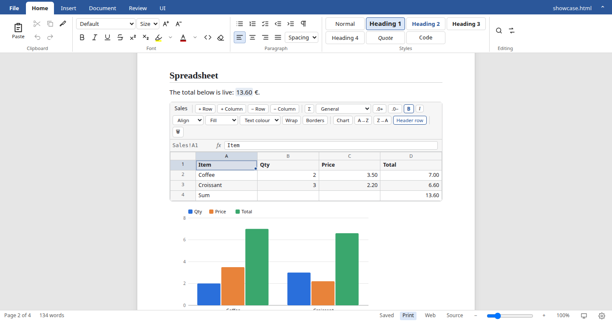

# Writy

A desktop editor for documents, spreadsheets and slides — with one open file format. Every document is a single **`.html` file**: any browser opens it, and
inside it carries its own editable [Djot](https://djot.net) source and pictures. Spec: [FORMAT.md](FORMAT.md).



## Features

- **Write:** Word-style ribbon, styles, fonts, colours, lists, autoformat, find & replace, format painter, formatting marks (¶)
- **Pages:** real pages with header/footer and page numbers, page size, margins, five designs, zoom
- **Insert:** tables, pictures, video, shapes (any-direction arrows and lines), equations, footnotes, links, contents, slides
- **Sheets:** Excel formulas (IronCalc), cross-sheet references, number formats, cell styles, fill series, charts, live values in the text
- **Slides:** slideshow (F5), presenter view with notes and timer
- **Review:** comments, track changes, Reviewing pane, word count
- **Open:** `.html`, `.dj`, `.md`, `.txt`, `.docx`, `.odt`, `.pdf`, `.csv`, `.xlsx`, `.ods`, `.doc` / `.rtf` (LibreOffice)
- **Save:** `.html` (native), `.dj`, `.md`, `.docx`, `.odt`, `.csv`; PDF through Print; Browser preview (Ctrl+F2)
- **Safe:** atomic saves, autosave with crash recovery
- **Clear split:** the **Document** tab is saved in the file (how it looks everywhere); the **UI** tab is only this app (theme, view, zoom)

## Run

Download the AppImage from [Releases](https://github.com/riagentic/writy/releases), or build and start it from source (installs what is missing):

```sh
curl -fsSL https://raw.githubusercontent.com/riagentic/aio/main/run.sh | sh -s riagentic/writy
```

In a checkout ([aio](https://github.com/riagentic/aio)'s `am` installed): `am start --client=electron` · `deno task compile` → `dist/writy-*.AppImage`.

Optional: `soffice` (.doc/.rtf import, .docx/.odt export) and `pdftohtml` from poppler (PDF import).

## Develop

| Task             | Command                                                                      |
| ---------------- | ---------------------------------------------------------------------------- |
| Gates            | `deno task check && deno task lint && deno task test && deno fmt --check`    |
| Rust core → WASM | `deno task core` · tests: `cd core && cargo test`                            |
| End-to-end       | `am start --client=server-only`, then `JW_URL=<url> deno test -A tests/e2e/` |
| Vendor bundle    | `deno task vendor` (ProseMirror / CodeMirror)                                |

```
core/         Rust → WASM: Djot, HTML render, file read/write, sheets, importers, MathML
src/editor/   ProseMirror schema, Djot ⇄ editor, node views, commands, session (open/save)
src/ui/       ribbon, backstage, status bar, panes, dialogs, slideshow, preview
src/server/   file system: dialogs, atomic write, drafts, LibreOffice / poppler
tests/        unit tests · e2e/ app + feature audit (99 steps, see AUDIT.md)
```

Plans and status: [IMPROVEMENTS.md](IMPROVEMENTS.md) · [AUDIT.md](AUDIT.md) · License: [MIT](LICENSE) · [third-party notices](THIRD_PARTY_NOTICES.md)
